# 🥉 Exercises XP

<div align="center">




</div>

A PostgreSQL script that creates an `items` table and a `customers` table, fills them with the exercise data and runs six `SELECT` queries.

## ▶️ How to run

```bash
psql -c "CREATE DATABASE xp_exercises"
psql -d xp_exercises -f items_customers.sql
```

The script drops both tables first, so it is safe to run again. In pgAdmin I create `xp_exercises`, open the Query Tool on it and run the file (the `CREATE DATABASE` line inside it is commented out).

## 🎯 The challenge

| Query | What it returns |
|---|---|
| All items | 3 rows: Small Desk (100), Large Desk (300), Fan (80) |
| `price > 80` | Small Desk and Large Desk (80 is not included) |
| `price <= 300` | All 3 items, cheapest first (300 is included) |
| `last_name = 'Smith'` | No rows: nobody in the data is called Smith |
| `last_name = 'Jones'` | Greg Jones and Sandra Jones |
| `first_name <> 'Scott'` | 4 customers: everyone except Scott Scott |

Both tables use a `SERIAL` primary key, and `items.price` has a `CHECK (price >= 0)` constraint. [`sample_outputs.txt`](sample_outputs.txt) lists the expected rows (its last query is printed in a different order than `ORDER BY last_name, first_name` gives).

## 🧠 What I learned

- In PostgreSQL `public` is a schema inside a database, not a database itself
- `DROP TABLE IF EXISTS` at the top makes a script easy to re-run
- `>` and `<=` decide whether the edge value (80 or 300) is included
- A query that matches nothing returns an empty result, not an error

---

## 👤 Author

**Kevin Cusnir 'Lirioth'**  
Repository: [Fullstack2026](https://github.com/LiriothTeltanion/Fullstack2026)  
Week 6 Day 1 - Introduction to Databases - Exercises XP
