# Day1 Introduction To Databases — Exercises XP Gold

<div align="center">




</div>

> Practice relational modeling, joins, constraints, CRUD operations, and PostgreSQL queries.

## Learning goals

- Practice: SQL.
- Validate normal inputs, edge cases, and failure states.
- Be able to explain the solution without reading the code line-by-line.

## How to run

```text
# Run exercisesxpgold.sql in PostgreSQL/pgAdmin against the required dataset
```

## Files

- `exercisesxpgold.sql`

## Verification checklist

- [ ] Main flow works
- [ ] Invalid input is handled
- [ ] Code is formatted
- [ ] Tests or repeatable manual checks exist
- [ ] README matches the current implementation

## Next improvement

Describe one concrete refactor, test, accessibility improvement, or product enhancement.
