# ➕ Exercises XP Plus

<div align="center">




</div>

One SQL script that creates a `students` table in the `bootcamp` database, inserts the exercise rows plus one row of my own, and runs the required queries.

## ▶️ How to run

```bash
psql -c "CREATE DATABASE bootcamp"
psql -d bootcamp -f exercisesxpplus.sql
```

The table is dropped and created again on every run. In pgAdmin I create `bootcamp`, open the Query Tool on it and run the file; each `SELECT` shows its own result grid.

## 🎯 The challenge

| Query | Condition | Returns |
|---|---|---|
| 1 | All columns | Every student |
| 2 | Only first and last names | Every student |
| a | `id = 2` | Yoan Cohen |
| b | `last_name = 'Benichou' AND first_name = 'Marc'` | Marc Benichou |
| c | `last_name = 'Benichou' OR first_name = 'Marc'` | Lea and Marc Benichou |
| d | First name contains `a` (`ILIKE '%a%'`) | Amelia, David, Lea, Marc, Yoan |
| e | First name starts with `a` (`ILIKE 'a%'`) | Amelia |
| f | First name ends with `a` (`ILIKE '%a'`) | Amelia, Lea |
| g | Second-to-last letter is `a` (`ILIKE '%a_'`) | Marc, Yoan |
| h | `id IN (1, 3)` | Marc and Lea Benichou |
| i | Born on or after 2000-01-01 (all columns) | David Grez and Yoan Cohen |

The exercise gives the dates as `dd/mm/yyyy`; I wrote them as ISO `yyyy-mm-dd` so PostgreSQL reads them the same way whatever its `DateStyle` setting is.

## 🧠 What I learned

- `GENERATED ALWAYS AS IDENTITY` gives each row an id without me typing it
- `ILIKE` is a case-insensitive `LIKE`: `%` matches any text and `_` exactly one character
- `AND` narrows a result, while `OR` widens it
- `IN (1, 3)` is a short way to write `id = 1 OR id = 3`

---

## 👤 Author

**Kevin Cusnir 'Lirioth'**  
Repository: [Fullstack2026](https://github.com/LiriothTeltanion/Fullstack2026)  
Week 6 Day 1 - Introduction to Databases - Exercises XP Plus
