# 📚 Exercises

Three XP levels, and each one is a single PostgreSQL script.

## Contents

- [`ExercisesXP/`](ExercisesXP/): `items` and `customers`, six filter queries
- [`ExercisesXPPlus/`](ExercisesXPPlus/): the `students` table and pattern matching with `ILIKE`
- [`ExercisesXPGold/`](ExercisesXPGold/): sorting and paging `students` with `LIMIT` and `OFFSET`

---

## 👤 Author

**Kevin Cusnir 'Lirioth'**  
Repository: [Fullstack2026](https://github.com/LiriothTeltanion/Fullstack2026)  
Week 6 Day 1 - Introduction to Databases - Exercises
