# 🗄️ Day 1 — Introduction to Databases

<div align="center">




</div>

Practice relational modeling, safe queries, joins, constraints, and persistent data workflows.

## Contents

- [`Exercises/`](Exercises/)

## Run

From the repository root:

```bash
psql -f Week6DatabasesAndNodejs/Day1IntroductionToDatabases/Exercises/ExercisesXP/items_customers.sql
psql -f Week6DatabasesAndNodejs/Day1IntroductionToDatabases/Exercises/ExercisesXPGold/exercisesxpgold.sql
psql -f Week6DatabasesAndNodejs/Day1IntroductionToDatabases/Exercises/ExercisesXPPlus/exercisesxpplus.sql
```
