# 💪 Daily Challenge - SQL Puzzle

<div align="center">




</div>

A four-question puzzle about `NOT IN` and `NULL`. [sql_puzzle.sql](sql_puzzle.sql) builds two tiny tables and writes the expected count and the reason next to every query.

## ▶️ How to run

```bash
createdb puzzle
psql -d puzzle -f sql_puzzle.sql
```

## 🎯 The challenge

`first_tab` has ids 5, 6, 7 and `NULL`. `second_tab` has 5 and `NULL`.

| Query | The subquery returns | Count |
|---|---|---|
| Q1 | only `NULL` | 0 |
| Q2 | only `5` | 2 (ids 6 and 7) |
| Q3 | `5` and `NULL` | 0 |
| Q4 | `5` (the `NULL` filtered out with `IS NOT NULL`) | 2 |
| Bonus | the same check with `NOT EXISTS` | 3 (6, 7 and the `NULL` row) |

I predicted the answers first, then checked them by running the same tables and queries in SQLite, which treats `NULL` in `NOT IN` the same way.

## 🧠 What I learned

- `x NOT IN (5, NULL)` means `x <> 5 AND x <> NULL`, and anything compared with `NULL` is unknown, so no row passes
- The row whose own id is `NULL` never passes a `NOT IN` either
- `NOT EXISTS` doesn't fall into the trap, which is why it is the safer way to write "not in the other table"

---

## 👤 Author

**Kevin Cusnir 'Lirioth'**  
Repository: [Fullstack2026](https://github.com/LiriothTeltanion/Fullstack2026)  
Week 6 Day 2 - Database Concepts I - Daily Challenge
