# Exercises XP — SQL Answers (PostgreSQL, pgAdmin / psql)

This pack contains a single **.sql** file with commented solutions for:
- Items & Customers (generic public schema)
- **dvdrental** sample database

Emojis are used for section markers (no hearts). Everything is in English.

## How to run
1. Open pgAdmin, connect to your server.
2. For **dvdrental** tasks, restore the `dvdrental` database if you haven't already.
3. Open the Query Tool for the right database.
4. Load `xp_sql_answers.sql` (folder icon), or copy–paste queries.
5. Run selected sections or the whole file.

## File
- `xp_sql_answers.sql` — annotated queries ready to execute.
