# 🥇 Exercises XP Gold

<div align="center">




</div>

Day 2 practice on my own data: [xp_gold_music_store.sql](xp_gold_music_store.sql) builds a small music store (artists, albums, tracks) and asks it seven questions.

## ▶️ How to run

```bash
createdb music_store
psql -d music_store -f xp_gold_music_store.sql
```

## 🎯 The challenge

1. Albums newest first, ties by title (`ORDER BY year DESC, title`).
2. Track lengths split into `minutes` and `extra_seconds` with `/` and `%`, using column aliases.
3. `SELECT DISTINCT country`: Israel, UK and USA once each.
4. The 3rd and 4th longest tracks with `LIMIT 2 OFFSET 2`.
5. `INNER JOIN` with table aliases (`al`, `ar`): every album next to its artist.
6. `LEFT JOIN` + `WHERE al.album_id IS NULL`: Bilmuri and Hayehudim, the artists with no album in the store.
7. Three tables joined: tracks over five minutes with album and artist. Four come back, from Sunbather (616 s) down to Luminary (333 s).

## 🧠 What I learned

- Dividing two integers in SQL drops the decimals, so `seconds / 60` already gives whole minutes
- `LEFT JOIN ... IS NULL` is the way to find rows that have no partner in the other table
- Short table aliases made the three-table join much easier to read
- `OFFSET` only makes sense with an `ORDER BY`, otherwise "the 3rd row" can change between runs

---

## 👤 Author

**Kevin Cusnir 'Lirioth'**  
Repository: [Fullstack2026](https://github.com/LiriothTeltanion/Fullstack2026)  
Week 6 Day 2 - Database Concepts I - Exercises XP Gold
