# 🥷 Exercises XP Ninja

<div align="center">




</div>

Seven harder questions on the `dvdrental` sample database, in [xp_ninja_dvdrental.sql](xp_ninja_dvdrental.sql).

## 🧩 Assignment practice: customers, purchases and joins

[required_customer_joins_demo.sql](required_customer_joins_demo.sql) adds the customer/purchase requirements as an independent synthetic transaction. The seven dvdrental questions below remain extra practice.

~~~bash
psql -v ON_ERROR_STOP=1 -d fullstack_practice -f required_customer_joins_demo.sql
~~~

Use a disposable practice database. BEGIN creates a separate schema and ROLLBACK removes all its demonstration objects and changes. An existing schema with the same name is not reused.

The last two names are selected by descending first name, then last name, projecting no ID. Deleting Scott's purchases does not delete his customer record. A separate purchase with a NULL customer reference survives a purchase-to-customer LEFT JOIN and is excluded by INNER JOIN.

A physically deleted purchase appears in neither join: LEFT JOIN can retain an existing unmatched row, but cannot reconstruct a deleted row. A customer-to-purchase LEFT JOIN still shows Scott with NULL purchase fields. The synthetic verification checks these distinctions and confirms the schema disappears after rollback.

## ▶️ How to run

This file only works on `dvdrental` (the PostgreSQL sample database from the course):

```bash
psql -d dvdrental -f xp_ninja_dvdrental.sql
```

## 🎯 The challenge

| Query | Question |
|---|---|
| 1 | The 5 longest films, with `length` also shown as text like `3h 5m`, built with `\|\|` |
| 2 | How many films each rating has (`GROUP BY rating`) |
| 3 | Customers whose first and last name start with the same letter (`LEFT(name, 1)`) |
| 4 | Films that cost more to replace than the average, with the average in a subquery |
| 5 | The 5 customers who paid the most, with `SUM(amount)` and `COUNT(*)` per customer |
| 6 | Actors in more than 35 films, filtered with `HAVING` |
| 7 | Films never rented, with two `LEFT JOIN`s and `rental_id IS NULL` |

## 🧠 What I learned

- `WHERE` filters rows before grouping and `HAVING` filters the groups after
- A subquery in `WHERE` lets me compare each film with a number computed from all films
- Grouping by `customer_id` is enough to also select the name, because the id is the primary key
- Query 7 also lists films that have no copy in `inventory` at all, since those can't have been rented either

---

## 👤 Author

**Kevin Cusnir 'Lirioth'**  
Repository: [Fullstack2026](https://github.com/LiriothTeltanion/Fullstack2026)  
Week 6 Day 2 - Database Concepts I - Exercises XP Ninja
