# 📚 Exercises

The Day 2 SQL exercises, all in one file.

## Contents

- [`ExercisesXP/`](ExercisesXP/) — sorting and limits on `items` and `customers`, then aliases, `DISTINCT`, joins and `NOT EXISTS` on `dvdrental`

---

## 👤 Author

**Kevin Cusnir 'Lirioth'**  
Repository: [Fullstack2026](https://github.com/LiriothTeltanion/Fullstack2026)  
Week 6 Day 2 - Database Concepts I - Exercises
