# 🔎 Day 2 — Database Concepts I

<div align="center">




</div>

Practice relational modeling, safe queries, joins, constraints, and persistent data workflows.

## Contents

- [`Exercises/`](Exercises/)

## Run

From the repository root:

```bash
psql -f Week6DatabasesAndNodejs/Day2DatabaseConcepts1/Exercises/ExercisesXP/xp_sql_answers.sql
```
