# 💪 Daily Challenge - Items and Orders

<div align="center">




</div>

Orders with several items each, and PL/pgSQL functions that add up the price. Everything is in [items_and_orders.sql](items_and_orders.sql).

## ▶️ How to run

```bash
createdb shop
psql -d shop -f items_and_orders.sql
```

The functions use PL/pgSQL, so this needs PostgreSQL.

## 🎯 The challenge

| Part | What it does |
|---|---|
| `users`, `product_orders`, `items` | A user has many orders, an order has many items. Both foreign keys use `ON DELETE CASCADE`. |
| `order_total(order_id)` | `SUM(price * quantity)` for one order, `COALESCE(..., 0)` when it has no items. Order 1 is 119.90, order 3 is 62.00. |
| `user_order_total(user_id, order_id)` | Bonus: the same total, but `NULL` when the order belongs to someone else. |
| Final query | Every order with its username and its total, calling the function inside `SELECT`. |

## 🧠 What I learned

- `SELECT ... INTO total` is how a PL/pgSQL function stores a query result in a variable
- Without `COALESCE`, an order with no items would return `NULL` instead of 0
- `IF NOT EXISTS (SELECT 1 ...)` is a cheap ownership check before doing the real work
- `CHECK (quantity > 0)` stops a bad row at the table, so the function never has to worry about it

---

## 👤 Author

**Kevin Cusnir 'Lirioth'**  
Repository: [Fullstack2026](https://github.com/LiriothTeltanion/Fullstack2026)  
Week 6 Day 3 - Database Concepts II - Daily Challenge
