# 💪 Daily Challenges

The daily challenges for this day. None of them are done yet.

## Contents

- [`TablesRelationships/`](TablesRelationships/): Tables Relationships: to do (required)
- [`ItemsAndOrders/`](ItemsAndOrders/): Items and Orders: to do (optional)

---

## 👤 Author

**Kevin Cusnir 'Lirioth'**  
Repository: [Fullstack2026](https://github.com/LiriothTeltanion/Fullstack2026)  
Week 6 Day 3 - Database Concepts II - Daily Challenges
