# 💪 Daily Challenge - Tables Relationships

<div align="center">




</div>

Both kinds of relationship from today's lesson in one file, [tables_relationships.sql](tables_relationships.sql): a customer with one profile (one-to-one) and students borrowing books (many-to-many).

## ▶️ How to run

```bash
createdb relationships
psql -d relationships -f tables_relationships.sql
```

## 🎯 The challenge

**Part I: customer and customer_profile**

1. `customer_profile.customer_id` is `UNIQUE` and `REFERENCES customer`, which makes it one-to-one.
2. John is logged in, Jerome isn't, and Lea has no profile.
3. `JOIN` lists the logged-in customers (John). `LEFT JOIN` lists everyone, with `NULL` for Lea.
4. `WHERE cp.is_logged_in IS NOT TRUE` counts the customers who are not logged in: 2, because a missing profile counts too.

**Part II: book, student and library**

1. `library` is the junction table; its primary key is the pair `(book_fk_id, student_fk_id)`.
2. Four loans, inserted with subqueries that find the ids by title and by name.
3. A three-table join shows who borrowed what, oldest loan first.
4. The average age of the children who borrowed Alice In Wonderland: 11.5.
5. Deleting Bob removes his two loans as well, thanks to `ON DELETE CASCADE`.

I checked the 11.5 average and the two rows left after the delete by running the same tables in SQLite with foreign keys switched on.

## 🧠 What I learned

- The only difference between one-to-one and one-to-many here is the `UNIQUE` on the foreign key
- `IS NOT TRUE` treats `NULL` like `FALSE`, while `= FALSE` would skip Lea
- Subqueries in `INSERT` saved me from guessing what ids `SERIAL` handed out

---

## 👤 Author

**Kevin Cusnir 'Lirioth'**  
Repository: [Fullstack2026](https://github.com/LiriothTeltanion/Fullstack2026)  
Week 6 Day 3 - Database Concepts II - Daily Challenge
