# 🥇 Exercises XP Gold

<div align="center">




</div>

SQL answers for two more `dvdrental` exercises: rentals that are still out, and a "Happy Halloween" plan that adds up viewing time per store.

## ▶️ How to run

```bash
psql -d dvdrental -f xp_gold_dvdrental.sql
```

It also creates the view `vw_film_actor_category` (dropping an older one first).

## 🎯 The challenge

**Exercise 1: DVD rentals**

1. Every rental that is still out, with the customer and the film title, newest first.
2. Customers with unreturned rentals and how many each one has.
3. Action films with Joe Swank, read from a view that joins `film`, `film_actor`, `actor`, `film_category` and `category`.

**Exercise 2: Happy Halloween**

- **A.** Each store with its address, city and country, plus the total number of stores.
- **B.** Viewing time per store in minutes, hours and days, counting only copies that are not rented out.
- **C and D.** Customers who live in the same cities, and in the same countries, as the stores.
- **E.** A "safe list": films that are not Horror and have none of beast, monster, ghost, dead, zombie or undead in the title or description (`~*` regex), with their total viewing time.
- **F.** The viewing time of all films, to compare with E.
- An extra query gives the safe viewing time per store, available copies only.

## 🧠 What I learned

- A view saves a long join, so later queries stay short
- A `WITH` block (CTE) names a step and makes a big query easier to read
- `~*` is a case-insensitive regex match in PostgreSQL
- Dividing by `60.0` instead of `60` keeps the decimals

---

## 👤 Author

**Kevin Cusnir 'Lirioth'**  
Repository: [Fullstack2026](https://github.com/LiriothTeltanion/Fullstack2026)  
Week 6 Day 3 - Database Concepts II - Exercises XP Gold
