# Exercises

<div align="center">




</div>

Practice relational modeling, safe queries, joins, constraints, and persistent data workflows.

## Contents

- [`ExercisesXP/`](ExercisesXP/)
- [`ExercisesXPGold/`](ExercisesXPGold/)

## Run

From the repository root:

```bash
psql -f Week6DatabasesAndNodejs/Day3DatabaseConcepts2/Exercises/ExercisesXP/xp_dvdrental_relationships.sql
psql -f Week6DatabasesAndNodejs/Day3DatabaseConcepts2/Exercises/ExercisesXPGold/xp_gold_dvdrental.sql
```
