# 🔗 Day 3 — Database Concepts II

How the tables in `dvdrental` connect: foreign keys, `ON DELETE CASCADE`, `LEFT JOIN`, a view, and questions that need four or five tables at once.

## Contents

| Folder | What it is |
|---|---|
| [`Exercises/ExercisesXP/`](Exercises/ExercisesXP/) | Film languages, two new linked tables and searches over rentals |
| [`Exercises/ExercisesXPGold/`](Exercises/ExercisesXPGold/) | Rentals still out and a "Happy Halloween" viewing-time plan per store |
| [`DailyChallenge/TablesRelationships/`](DailyChallenge/TablesRelationships/) | Tables Relationships: to do (required) |
| [`DailyChallenge/ItemsAndOrders/`](DailyChallenge/ItemsAndOrders/) | Items and Orders: to do (optional) |
| [`Exercises/ExercisesXPNinja/`](Exercises/ExercisesXPNinja/) | Exercises XP Ninja: to do (optional) |

---

## 👤 Author

**Kevin Cusnir 'Lirioth'**  
Repository: [Fullstack2026](https://github.com/LiriothTeltanion/Fullstack2026)  
Week 6 Day 3 - Database Concepts II
