# 💪 Daily Challenge - Node.js App and NPM

<div align="center">




</div>

A small Node.js project built up in three steps: my own CommonJS module, an npm package (`chalk`), and reading a file with `fs`. At the end `challenge.js` puts the three pieces together.

## ▶️ How to run

From this folder. `chalk` is only needed for task 2 and `challenge.js`:

```bash
npm install
node task-1/app.js
node task-2/app.js
node task-3/app.js
node challenge.js
```

```
🚀 Challenge — Integration Demo
Hello, Developer! 👋
 Daily Challenge  Running Task 2 ✅
💡 Tip: Try editing the message styles for fun!
📄 File content:
This is a tiny data file for the daily challenge.
It demonstrates reading with Node's fs module. ✅

✅ Done.
🎉 Challenge complete.
```

## 🎯 The challenge

| Module | What it does |
|---|---|
| `greeting.js` | `greet(name)` returns `Hello, <name>! 👋`, falling back to `friend` for an empty name |
| `colorful-message.js` | `showColorfulMessage()` prints a title on a blue background and a yellow tip, using `chalk` |
| `read-file.js` | `readAndPrint(relativePath)` reads `files/file-data.txt` by default with `fs.promises` and prints it |
| `challenge.js` | An `async` arrow function that calls the three modules one after another |

The tasks live in [`task-1/`](task-1/) (greeting), [`task-2/`](task-2/) (`chalk`) and [`task-3/`](task-3/) (file reading), and [`files/`](files/) has the text file. Each `app.js` is only a few lines, because the real code sits in the shared modules one level up.

## 🧠 What I learned

- Putting the three modules next to `challenge.js` meant the tasks and the final script could share them
- `require("../greeting")` is how a task folder reaches a file one level up
- `path.resolve(__dirname, ...)` inside `read-file.js` finds the text file no matter where I start Node from
- Ending `challenge.js` with `.catch(() => process.exit(1))` makes a failed read end the script with an error code

---

## 👤 Author

**Kevin Cusnir 'Lirioth'**  
Repository: [Fullstack2026](https://github.com/LiriothTeltanion/Fullstack2026)  
Week 6 Day 4 - Introduction to Node.js - Daily Challenge
