# 🧪 Task 1 - Basic Module System

<div align="center">




</div>

The first task only uses `greet()` from the shared [`greeting.js`](../greeting.js) module.

## ▶️ How to run

```bash
node app.js
```

```
🧪 Task 1 — Basic Module System
Hello, Kevin! 👋
Hello, Sam! 👋
Hello, friend! 👋
```

Nothing to install for this one.

## 🎯 The challenge

- `app.js` gets the function with `const { greet } = require("../greeting")` and calls it with `"Kevin"`, `"Sam"` and an empty string.
- `greet(name)` trims the name, and if it ends up empty (or isn't a string at all) it says `friend` instead.

## 🧠 What I learned

- `module.exports = { greet }` on one side and `const { greet } = require(...)` on the other is the whole CommonJS deal
- The empty-string call is there on purpose, to see the `friend` fallback work
- Checking `typeof name === "string"` before `trim()` stops a crash if someone passes a number

---

## 👤 Author

**Kevin Cusnir 'Lirioth'**  
Repository: [Fullstack2026](https://github.com/LiriothTeltanion/Fullstack2026)  
Week 6 Day 4 - Introduction to Node.js - Task 1
