# Task 2

<div align="center">




</div>

Practice relational modeling, safe queries, joins, constraints, and persistent data workflows.

## Contents

- [`app.js`](app.js)

## Run

From the repository root:

```bash
node Week6DatabasesAndNodejs/Day4NodejsIntroduction/DailyChallenge/NodejsAppAndNPM/task-2/app.js
```
