# 🧪 Task 3 - Advanced File Operations

<div align="center">




</div>

Task 3 of the daily challenge: read and print [`files/file-data.txt`](../files/file-data.txt) through [`read-file.js`](../read-file.js).

## ▶️ How to run

```bash
node app.js
```

```
🧪 Task 3 — Advanced File Operations
📄 File content:
This is a tiny data file for the daily challenge.
It demonstrates reading with Node's fs module. ✅

✅ Done.
```

## 🎯 The challenge

- `readAndPrint(relativePath = "./files/file-data.txt")` builds the full path with `path.resolve(__dirname, relativePath)`, reads it with `fs.promises.readFile` and prints it.
- If the file is missing it prints `❌ Failed to read: …` and throws, and `app.js` exits with code 1.

## 🧠 What I learned

- `fs.promises` returns promises, so the read can be awaited
- A default parameter gives the function a sensible path when none is passed
- `__dirname` belongs to the module file, so the path also works when the script starts in `task-3/`

---

## 👤 Author

**Kevin Cusnir 'Lirioth'**  
Repository: [Fullstack2026](https://github.com/LiriothTeltanion/Fullstack2026)  
Week 6 Day 4 - Introduction to Node.js - Task 3
