# 💪 Daily Challenges

One daily challenge, split into three tasks.

## Contents

- [`NodejsAppAndNPM/`](NodejsAppAndNPM/): a CommonJS module, the `chalk` package and `fs`, one per task, and then all three in `challenge.js`

---

## 👤 Author

**Kevin Cusnir 'Lirioth'**  
Repository: [Fullstack2026](https://github.com/LiriothTeltanion/Fullstack2026)  
Week 6 Day 4 - Introduction to Node.js - Daily Challenges
