# 🥉 Exercises XP

Seven small Node.js exercises (Node 18 or newer). Each one runs inside its own folder, after `npm install` when it uses a package.

## Contents

- [`exercise-1-commonjs-products/`](exercise-1-commonjs-products/) — a product list exported with `module.exports` and a search by name
- [`exercise-2-esm-average-age/`](exercise-2-esm-average-age/) — an ES module array of people and their average age
- [`exercise-3-file-manager-commonjs/`](exercise-3-file-manager-commonjs/) — `readFile` and `writeFile` helpers used on two text files
- [`exercise-4-esm-todo/`](exercise-4-esm-todo/) — a `TodoList` class written as an ES module
- [`exercise-5-math-app/`](exercise-5-math-app/) — my own `add` and `multiply` module together with `lodash`
- [`exercise-6-npm-beginner-chalk/`](exercise-6-npm-beginner-chalk/) — a first colorful message with `chalk`
- [`exercise-7-file-explorer/`](exercise-7-file-explorer/) — copying a file and listing a folder with `fs`

---

## 👤 Author

**Kevin Cusnir 'Lirioth'**  
Repository: [Fullstack2026](https://github.com/LiriothTeltanion/Fullstack2026)  
Week 6 Day 4 - Introduction to Node.js - Exercises XP
