# 🧪 Exercise 1 - CommonJS Products

<div align="center">




</div>

Five products in one file, shared with CommonJS, and a second file that searches them by name.

## ▶️ How to run

```bash
node shop.js
```

```
✅ Found: Mechanical Keyboard — $99 [Peripherals]
✅ Found: USB-C Hub — $39 [Accessories]
❌ Not found: Unknown
```

## 🎯 The challenge

| File | What it does |
|---|---|
| `products.js` | `module.exports = products`: an array of five items with `name`, `price` and `category` |
| `shop.js` | Loads the list with `require("./products")`. `findProductByName(name)` trims and lowercases the name, finds the match and returns it or `null`. An empty or non-string name prints a warning first. The file then searches for three names as a demo. |

`shop.js` also exports `findProductByName`, but since the demo runs at the top level it would print its three lines if another file required it.

## 🧠 What I learned

- Whatever I assign to `module.exports` is exactly what `require()` hands back, here a plain array
- `find()` gives `undefined` when nothing matches, so `hit || null` makes the "not found" value explicit
- Lowercasing both sides is enough for a case-insensitive name search
- Checking for an empty name at the top keeps the rest of the function simple

---

## 👤 Author

**Kevin Cusnir 'Lirioth'**  
Repository: [Fullstack2026](https://github.com/LiriothTeltanion/Fullstack2026)  
Week 6 Day 4 - Introduction to Node.js - Exercise 1
