# 🧪 Exercise 2 - ESM Average Age

<div align="center">




</div>

Same idea as exercise 1, but with ES modules: `data.js` exports a list of people and `app.js` imports it to print their average age.

## ▶️ How to run

```bash
node app.js
```

```
🧠 Average age across 4 people: 29
```

## 🎯 The challenge

| File | What it does |
|---|---|
| `data.js` | `export const people`: four people with `name`, `age` and `location` |
| `app.js` | `import { people } from "./data.js"`. `averageAge(arr)` sums the ages with `reduce`, divides by the length and rounds to two decimals. An empty or missing list prints a warning and returns 0. |

The ages are 28, 34, 23 and 31, so the sum is 116 and the average comes out as a round 29. `package.json` has `"type": "module"`, otherwise Node wouldn't accept `import` in a `.js` file.

## 🧠 What I learned

- One line, `"type": "module"`, is what switches the folder from CommonJS to ES modules
- With `import` I have to write the extension: `./data.js`, not `./data`
- `Math.round(x * 100) / 100` is a simple way to keep two decimals
- The empty-list check is what keeps `averageAge([])` from dividing by zero

---

## 👤 Author

**Kevin Cusnir 'Lirioth'**  
Repository: [Fullstack2026](https://github.com/LiriothTeltanion/Fullstack2026)  
Week 6 Day 4 - Introduction to Node.js - Exercise 2
