# 🧪 Exercise 4 - ESM Todo List

A to-do list written with ES modules. The code lives in the `todoApp/` folder.

## Contents

- [`todoApp/`](todoApp/) — the `TodoList` class and a script that adds, completes and lists tasks

---

## 👤 Author

**Kevin Cusnir 'Lirioth'**  
Repository: [Fullstack2026](https://github.com/LiriothTeltanion/Fullstack2026)  
Week 6 Day 4 - Introduction to Node.js - Exercise 4
