# 🧪 Exercise 4 - Todo App

<div align="center">




</div>

`todo.js` exports a `TodoList` class, and `app.js` uses it: three tasks go in, two get marked as done, and the list is printed.

## ▶️ How to run

```bash
node app.js
```

```
🧠 Current tasks:
- [✅ done] (1) Review PR #42
- [⏳ pending] (2) Write unit tests
- [✅ done] (3) Water the cactus 🌵
```

## 🎯 The challenge

| Method | What it does |
|---|---|
| `add(text)` | Trims the text, gives it the next id and stores `{ id, text, done: false }`; empty text throws an error |
| `complete(id)` | Sets `done` to `true`, or returns `false` when there is no task with that id |
| `list()` | Returns a copy of the tasks array |

Nothing is saved to disk, so every run starts from an empty list. `package.json` has `"type": "module"` so `import` and `export` work.

## 🧠 What I learned

- `export class TodoList` shares the whole class, and `app.js` makes its own instance with `new`
- `this._nextId++` hands out 1, 2, 3 in order, so no two tasks ever share an id
- `list()` returns `[...this.tasks]`, so code outside can't push into the real array (the task objects themselves are still shared)
- Throwing on empty text is louder than quietly skipping it, which is what I wanted here

---

## 👤 Author

**Kevin Cusnir 'Lirioth'**  
Repository: [Fullstack2026](https://github.com/LiriothTeltanion/Fullstack2026)  
Week 6 Day 4 - Introduction to Node.js - Exercise 4
