# 🧪 Exercise 5 - Math App

My own math module used together with the `lodash` package. The code lives in the `math-app/` folder.

## Contents

- [`math-app/`](math-app/) — `add` and `multiply` in `math.js`, and `app.js` that combines them with `lodash`

---

## 👤 Author

**Kevin Cusnir 'Lirioth'**  
Repository: [Fullstack2026](https://github.com/LiriothTeltanion/Fullstack2026)  
Week 6 Day 4 - Introduction to Node.js - Exercise 5
