# 🧪 Exercise 5 - Math App

<div align="center">




</div>

`math.js` is a CommonJS module with `add` and `multiply`. `app.js` loads it together with the `lodash` package and works on a short list of numbers.

## ▶️ How to run

```bash
npm install
node app.js
```

```
🧠 Unique numbers: 2, 3, 6
✅ Sum: 11
⚙️  Product: 36
```

## 🎯 The challenge

| Function | What it does |
|---|---|
| `add(a, b)` | Runs both values through `Number()` and adds them |
| `multiply(a, b)` | Runs both values through `Number()` and multiplies them |

`app.js` starts from `[2, 2, 3, 3, 3, 6]`. `_.uniq` drops the repeats, `_.sortBy` sorts what's left, and two `reduce` calls use my helpers: the sum starts at 0 and the product starts at 1.

## 🧪 Tests

From the repository root:

```bash
node --test tests/js/math_helpers.test.mjs
```

1 test finds this `math.js`, loads it and checks that `add(2, 3)` is 5 and `multiply(4, 5)` is 20.

## 🧠 What I learned

- `npm install` reads `package.json` and puts `lodash` in `node_modules`; that folder stays out of Git
- `require("./math")` loads my file, while `require("lodash")` with no `./` loads a package
- The starting value of `reduce` matters: 0 for a sum, 1 for a product
- Because `add` and `multiply` only return values, the test can check them without running `app.js`

---

## 👤 Author

**Kevin Cusnir 'Lirioth'**  
Repository: [Fullstack2026](https://github.com/LiriothTeltanion/Fullstack2026)  
Week 6 Day 4 - Introduction to Node.js - Exercise 5
