# Exercise 6 npm Beginner Chalk

<div align="center">




</div>

> Practice relational modeling, joins, constraints, CRUD operations, and PostgreSQL queries.

## Learning goals

- Practice: JSON, JavaScript.
- Validate normal inputs, edge cases, and failure states.
- Be able to explain the solution without reading the code line-by-line.

## How to run

```text
node npm-beginner/app.js
```

## Files

- `npm-beginner/app.js`

## Verification checklist

- [ ] Main flow works
- [ ] Invalid input is handled
- [ ] Code is formatted
- [ ] Tests or repeatable manual checks exist
- [ ] README matches the current implementation

## Next improvement

Describe one concrete refactor, test, accessibility improvement, or product enhancement.
