# 🧪 Exercise 6 - npm Beginner

<div align="center">




</div>

`app.js` uses the `chalk` package to print three styled lines in the terminal. That's the whole exercise: install a package and use it.

## ▶️ How to run

```bash
npm install
node app.js
```

```
Welcome to the  NPM Beginner  demo!
✅ Success: You just printed a colorful message.
💡 Tip: Try different chalk styles like underline, italic, or inverse.
```

In the terminal the first line is bold with " NPM Beginner " in white on blue, the labels are green and yellow, and the last three style names are shown underlined, in italics and inverted.

## 🎯 The challenge

- `package.json` asks for `chalk` `^4.1.2`. Version 4 still loads with `require()`; from version 5 on it is ES modules only.
- Each line is built by adding styled pieces with `+`, for example `chalk.bold("Welcome to the ") + chalk.bgBlue.white(" NPM Beginner ")`.
- `chalk.reset(...)` switches back to plain text in the middle of a line.

## 🧠 What I learned

- The `^` in `^4.1.2` lets npm install newer 4.x versions but never jump to 5
- Gluing strings with `+` works because each chalk call just returns a string with color codes inside
- The tip line shows each style on the word that names it, which made it easy to see what `underline`, `italic` and `inverse` do

---

## 👤 Author

**Kevin Cusnir 'Lirioth'**  
Repository: [Fullstack2026](https://github.com/LiriothTeltanion/Fullstack2026)  
Week 6 Day 4 - Introduction to Node.js - Exercise 6
