# 🧪 Exercise 7 - File Explorer

Reading, copying and listing files with `fs`. The code lives in the `file-explorer/` folder.

## Contents

- [`file-explorer/`](file-explorer/) — `copy-file.js` copies `source.txt`, `read-directory.js` lists the folder

---

## 👤 Author

**Kevin Cusnir 'Lirioth'**  
Repository: [Fullstack2026](https://github.com/LiriothTeltanion/Fullstack2026)  
Week 6 Day 4 - Introduction to Node.js - Exercise 7
