# File explorer

Practice relational modeling, safe queries, joins, constraints, and persistent data workflows.

## Contents

- [`copy-file.js`](copy-file.js)
- [`package.json`](package.json)
- [`read-directory.js`](read-directory.js)
- [`source.txt`](source.txt)
