# 🥇 Exercises XP Gold

<div align="center">




</div>

Five small scripts, one built-in Node module each: `os`, `path`, `events`, `fs/promises` and `process.argv`. No packages to install.

## ▶️ How to run

From this folder (each one also has an npm script in [package.json](package.json)):

```bash
node system-info.js
node path-explorer.js
node events-demo.js
node json-store.js
node calculator.js 12 x 3.5
```

`events-demo.js` prints:

```
Order #1: 2 x coffee beans
  (first order of the day, this message shows once)
Order #2: 50 x paper cups
  -> big order, tell the warehouse about #2
Rejected milk: quantity must be positive
Listeners on 'placed' now: 1
```

## 🎯 The challenge

| File | What it does |
|---|---|
| [system-info.js](system-info.js) | Platform, CPU cores, free and total memory in GB, uptime in hours, Node version and the line ending (`"\r\n"` on my Windows PC) |
| [path-explorer.js](path-explorer.js) | `path.parse()`, `extname()`, `join()` with `..`, and `format()` to swap `.wav` for `.mp3`. Builds `__dirname` from `import.meta.url` |
| [events-demo.js](events-demo.js) | An `OrderSystem` class that extends `EventEmitter` and emits `placed`, `bigOrder` and `rejected` |
| [json-store.js](json-store.js) | Loads, changes and saves a JSON file three times, then deletes it. It writes to the system temp folder, so the repo stays clean |
| [calculator.js](calculator.js) | `node calculator.js 12 x 3.5` prints `12 x 3.5 = 42`; dividing by 0 and unknown operators get a message |

## 🧠 What I learned

- ES modules have no `__dirname`; `fileURLToPath(import.meta.url)` gives it back
- A listener added with `once()` removes itself after the first event, which is why only one listener is left
- `readFile` on a missing file throws with `code === "ENOENT"`, and I use that as "first run, start empty"
- I used `x` for multiply because the shell expands `*` into file names before Node sees it

---

## 👤 Author

**Kevin Cusnir 'Lirioth'**  
Repository: [Fullstack2026](https://github.com/LiriothTeltanion/Fullstack2026)  
Week 6 Day 4 - Introduction to Node.js - Exercises XP Gold
