# 🥷 Exercises XP Ninja

<div align="center">




</div>

Four native Node examples cover streams, recursive directory traversal, logging and timers. The command-line app below adds an interactive city weather dashboard alongside the original scripts.

## Stage tools

Use Node 24 or later and install the locked dependencies with `npm ci` in this directory.

| Command | What happens |
| --- | --- |
| `npm run cli -- greet "Sam Reed"` | Print a greeting using Chalk, with color on supported terminals. |
| `npm run cli -- fetch 2` | Use Axios to request a sample post from JSONPlaceholder and display its title and body. |
| `npm run cli -- read sample.txt` | Read a local UTF-8 file, preserving its contents and line endings. |
| `npm run weather` | Enter a city at the prompt. A blank line lets you try again. |
| `npm run weather -- "Berlin"` | Run the same weather lookup directly for a supplied city. |

Commander dispatches the greeting, fetch and file commands to individual modules. The weather dashboard displays the first city match, its region and country, the local observation time, temperature in Celsius and wind speed in km/h. The weather client first resolves the city to coordinates, then requests its current conditions. An unavailable service or an unmatched city produces a readable error and a nonzero exit code.

Weather data comes from [Open-Meteo](https://open-meteo.com/). The exercise uses its [geocoding](https://open-meteo.com/en/docs/geocoding-api) and [forecast APIs](https://open-meteo.com/en/docs) under their [terms of use](https://open-meteo.com/en/terms). A network connection is required for the `fetch` and `weather` commands. No API key is needed for this noncommercial example.

Run `npm test` for offline tests of the commands, prompt, lookup failures and presentation. Each service test supplies local example responses.

## Original native-module exercises

## ▶️ How to run

```bash
node word-count.js sample.txt
node tree.js .
node use-logger.js
node countdown.js 3
```

```
sample.txt: 5 lines, 70 words
Most used words:
  file     5
  lines    2
  piece    2
  reads    2
  stream   2
```

## 🎯 The challenge

| File | What it does |
|---|---|
| [word-count.js](word-count.js) | Reads [sample.txt](sample.txt) line by line with `createReadStream` + `readline` and `for await`, counts lines and words, and lists the top 5 words (skipping words like "the" and "a") |
| [tree.js](tree.js) | Prints a folder as a tree with `├──` and `└──`, folders first, going into sub-folders with recursion and skipping `node_modules` and `.git` |
| [logger.js](logger.js) + [use-logger.js](use-logger.js) | `createLogger(name, minLevel)` returns `debug`/`info`/`warn`/`error` functions that add a time and skip messages under the chosen level |
| [countdown.js](countdown.js) | `setInterval` once a second, `clearInterval` at zero, and a `SIGINT` handler so Ctrl+C prints how many seconds were left |

## 🧠 What I learned

- A stream reads the file in pieces, so the same code would work on a file much bigger than memory
- `withFileTypes: true` gives `isDirectory()` without a second call to `stat()`
- The logger is a closure: each logger keeps its own `lines` array and level
- Forgetting `clearInterval` would keep the process alive forever, since an active timer stops Node from exiting

---

## 👤 Author

**Kevin Cusnir 'Lirioth'**  
Repository: [Fullstack2026](https://github.com/LiriothTeltanion/Fullstack2026)  
Week 6 Day 4 - Introduction to Node.js - Exercises XP Ninja
