# 🧪 Exercise - More Node.js Challenges

<div align="center">




</div>

## 📅 Calendar challenges

Find out how long it is until the next January 1, how many whole minutes have elapsed since a birth date, and which Israeli public holiday is underway or coming next. From this directory, run:

```sh
npm ci
node calendar-cli.js
node calendar-cli.js 2000-01-01
node calendar-cli.js --ask
npm test
```

Use the sample date or enter a date at the prompt. The calendar prints its answer and does not store your input. An impossible date (for example, `2023-02-29`) or a future date returns an error and exit code 1.

[The calendar module](calendar.js) exports three functions. Each accepts a reference clock so the tests can reproduce a leap day, midnight on New Year's Eve, or the precise instant a holiday begins.

| Function | Convention |
| --- | --- |
| `timeUntilNewYear(now)` | Milliseconds until the next January 1 at 00:00 UTC. |
| `minutesLived('YYYY-MM-DD', now)` | Whole minutes from midnight UTC on the supplied date. A date without a birth time gives a date-based estimate. |
| `nextHoliday(now)` | The holiday's name, start, remaining milliseconds and whether it is already underway. The CLI displays the start in Jerusalem time. |

The holiday lookup uses the installed [date-holidays calendar](https://github.com/commenthol/date-holidays) and works offline after installation. It uses the package's public-holiday list and start/end times for Israel, including holidays that start in the evening. The supported years are 1970–2100. After the last listed holiday in 2100 the program reports that the next one is unavailable.

## 📝 Notes CLI

A notes app for the terminal. [notes.js](notes.js) reads the command, and [notesStore.js](notesStore.js) loads, changes and saves the notes in a `notes.json` file next to them.

## ▶️ How to run

```bash
node notes.js add "Shopping" "Guitar strings and a capo"
node notes.js add "Course" "Finish the Week 6 SQL challenges"
node notes.js list
node notes.js search guitar
node notes.js read 2
node notes.js remove 1
```

```
Added note #1: Shopping
Added note #2: Course
2 note(s):
#1 Shopping (2026-11-25)
#2 Course (2026-11-25)
1 match(es) for "guitar"
#1 Shopping (2026-11-25)
#2 Course (2026-11-25)
Finish the Week 6 SQL challenges
Removed note #1
```

`notes.json` is in the folder's `.gitignore`, because it holds my own notes, not code.

## 🎯 The challenge

| Command | What happens |
|---|---|
| `add "Title" "Body"` | `addNote()` refuses a title that already exists (ignoring case) and gives the next free id |
| `list` | Every note with its id and date, or "No notes yet." |
| `read <id>` | One note with its body |
| `search <text>` | `searchNotes()` looks in titles and bodies |
| `remove <id>` | `removeNote()` throws when the id doesn't exist |

Unknown commands print the list of commands and exit with code 1.

## 🧠 What I learned

- Splitting the file work (`notesStore.js`) from the command handling (`notes.js`) kept both files short
- `addNote()` and `removeNote()` return a new array instead of changing the old one, so saving is a separate, clear step
- An object of async functions (`commands[command]` called with `...args`) works as a small command router
- Setting `process.exitCode = 1` marks the run as failed without cutting off the output

---

## 👤 Author

**Kevin Cusnir 'Lirioth'**  
Repository: [Fullstack2026](https://github.com/LiriothTeltanion/Fullstack2026)  
Week 6 Day 4 - Introduction to Node.js - Exercise
