# Exercises

<div align="center">




</div>

Practice relational modeling, safe queries, joins, constraints, and persistent data workflows.

## Contents

- [`ExercisesXP/`](ExercisesXP/)

## Run

From the repository root:

```bash
node Week6DatabasesAndNodejs/Day4NodejsIntroduction/Exercises/ExercisesXP/exercise-2-esm-average-age/app.js
```
