# 🟢 Day 4 — Introduction to Node.js

My first day with Node.js: `require` and `import`, npm packages (`chalk`, `lodash`) and reading and writing files with `fs`.

## Contents

| Folder | What it is |
|---|---|
| [`Exercises/ExercisesXP/`](Exercises/ExercisesXP/) | Seven small exercises, each in its own folder |
| [`DailyChallenge/NodejsAppAndNPM/`](DailyChallenge/NodejsAppAndNPM/) | Three tasks and a script that combines a greeting module, `chalk` and `fs` |
| [`Exercises/ExercisesXPGold/`](Exercises/ExercisesXPGold/) | `os`, `path`, `events`, `fs/promises` and a command-line calculator |
| [`Exercises/ExercisesXPNinja/`](Exercises/ExercisesXPNinja/) | a stream word counter, a folder tree, a logger module and a countdown |
| [`Exercises/MoreNodejsChallenges/`](Exercises/MoreNodejsChallenges/) | a command-line notes app saved in a JSON file |

---

## 👤 Author

**Kevin Cusnir 'Lirioth'**  
Repository: [Fullstack2026](https://github.com/LiriothTeltanion/Fullstack2026)  
Week 6 Day 4 - Introduction to Node.js
