# 💪 Daily Challenge - Emoji Guessing Game

<div align="center">




</div>

A guessing game served by my own Node.js server: the page shows an emoji, I pick its name from four options, and the server keeps the score and a leaderboard. Express receives the requests and the route handler returns JSON or the static game page.

## ▶️ How to run

```bash
npm install
node server.js
```

Then open `http://localhost:3030`, type a player name and start guessing. `PORT=4000 node server.js` picks another port.

A round and a guess from the API, as I tested it with `curl`:

```
GET /api/round
{"roundId":"ec32cac2-...","emoji":"😀","options":["Smile","Headphones","Dog","Owl"]}
POST /api/guess {"roundId":"ec32cac2-...","player":"Dana","guess":"Smile"}
{"correct":true,"answer":"Smile","player":{"name":"Dana","score":1,"rounds":2,"streak":1}}
```

## 🎯 The challenge

| Part | What it does |
|---|---|
| [game.js](game.js) | Ten emojis, `createRound()` (shuffle, pick four, one is the answer) and `createScoreboard()` |
| [server.js](server.js) `GET /api/round` | Creates a round, keeps the answer in a `Map` under a `randomUUID()` and sends only the emoji and the options |
| `POST /api/guess` | Checks the guess, deletes the round (one guess each) and updates the player's score and streak |
| `GET /api/leaderboard` | The top 5 players by score |
| [public/](public/) | The page, its styles and `app.js`, which calls the API with `fetch` |

Scoring: a right answer is 1 point, and from the third right answer in a row it's 2. A wrong answer resets the streak. Scores live in memory, so they reset when the server restarts.

## 🧠 What I learned

- Keeping the answer on the server is what stops someone from reading it in the browser's network tab
- Deleting the round after one guess means the same round can't be answered twice
- Putting the game rules in `game.js` left `server.js` with only routing and HTTP details
- `path.basename()` on the requested file stops `../` tricks in the static file handler

---

## 👤 Author

**Kevin Cusnir 'Lirioth'**  
Repository: [Fullstack2026](https://github.com/LiriothTeltanion/Fullstack2026)  
Week 6 Day 5 - Node.js Web Server - Daily Challenge

## Verification · 2026-11-25

The Express adapter retains the round, guess and leaderboard JSON endpoints. The earlier Node-only server is preserved in Git history and the dated private backup.
