# 📁 Public - Emoji Guessing Game

What the browser gets from `../server.js`: the game page, its styles and the script that talks to the API.

## Contents

- [`index.html`](index.html): name field, the emoji card with four answer buttons, score, streak and leaderboard
- [`style.css`](style.css): dark layout, a two-column grid for the options and focus rings
- [`app.js`](app.js): `loadRound()`, `sendGuess()` and `loadLeaderboard()` with `fetch`

---

## 👤 Author

**Kevin Cusnir 'Lirioth'**  
Repository: [Fullstack2026](https://github.com/LiriothTeltanion/Fullstack2026)  
Week 6 Day 5 - Node.js Web Server - Emoji Guessing Game
