# 🥉 Exercises XP

<div align="center">




</div>

Five web servers that build on each other, from plain text to JSON routes, a file from disk and my own module. Only Node's `http` module, nothing to install.

## ▶️ How to run

Each server has its own port, so they can run side by side:

```bash
node ex1-hello-server.js   # http://localhost:3000
node ex2-html-server.js    # http://localhost:3001
node ex3-json-routes.js    # http://localhost:3002
node ex4-static-page.js    # http://localhost:3003
node ex5-date-server.js    # http://localhost:3004
```

What `curl` got back from Exercise 3:

```
GET /api/users -> 200 [{"id":1,"name":"Dana","role":"student"},{"id":2,"name":"Omer","role":"mentor"}]
GET /nope      -> 404 {"error":"No route for /nope"}
```

## 🎯 The challenge

1. [ex1-hello-server.js](ex1-hello-server.js): `http.createServer()` answers plain text with the URL that was asked for.
2. [ex2-html-server.js](ex2-html-server.js): the same, but an HTML string with `Content-Type: text/html`.
3. [ex3-json-routes.js](ex3-json-routes.js): a `switch` on `req.url` for `/`, `/about` and `/api/users`, 404 for anything else and 405 for methods other than GET.
4. [ex4-static-page.js](ex4-static-page.js): reads [public/index.html](public/index.html) with `fs/promises` on every request and answers 500 if the file is missing.
5. [ex5-date-server.js](ex5-date-server.js): imports `formatNow()` and `daysUntil()` from [dateUtils.js](dateUtils.js) and prints the date and the days left to New Year and to 1 April.

## 🧠 What I learned

- Without the right `Content-Type`, the browser shows HTML as plain text
- `res.end()` is what finishes the response; forgetting it leaves the browser loading forever
- A `sendJson()` helper removed the same two lines from every route
- `Number(process.env.PORT) || 3000` lets me change the port without touching the code

---

## 👤 Author

**Kevin Cusnir 'Lirioth'**  
Repository: [Fullstack2026](https://github.com/LiriothTeltanion/Fullstack2026)  
Week 6 Day 5 - Node.js Web Server - Exercises XP
