# 📁 Public - Exercises XP

The page that Exercise 4 reads from disk on every request.

## Contents

- [`index.html`](index.html): a short page with its own inline styles

---

## 👤 Author

**Kevin Cusnir 'Lirioth'**  
Repository: [Fullstack2026](https://github.com/LiriothTeltanion/Fullstack2026)  
Week 6 Day 5 - Node.js Web Server - Exercises XP
