# 🥇 Exercises XP Gold

<div align="center">




</div>

## Run the three Express exercises

Install the locked packages with `npm ci`. Run `npm run practice` to start the Express API on `http://127.0.0.1:3100`. The original native HTTP exercise still runs separately with `npm start`.

| Exercise | Requests to try | Behavior |
| --- | --- | --- |
| External posts | `GET /posts`, `GET /posts/1`, `POST /posts`, `PUT /posts/1`, `DELETE /posts/1` | Axios forwards requests to JSONPlaceholder. For a write, send a nonempty `title` and `body` plus a positive integer `userId`. Missing posts and upstream outages produce different responses. |
| Accounts | `POST /auth/register`, `POST /auth/login`, `GET /auth/profile` | Register a synthetic username and password. Log in with the same credentials, then send the returned token in `Authorization: Bearer <token>` to read your profile. |
| Todos | `GET /todos`, `POST /todos`, `GET /todos/1`, `PATCH /todos/1`, `PUT /todos/1`, `DELETE /todos/1` | Create a task with a `title`. The optional `completed` field is a boolean and defaults to `false`. Patch one field or replace the full task with PUT. |

The three routers are independent. Passwords are hashed with bcrypt. A signed token expires after 15 minutes. Users, the signing key and todos live in memory for a single practice session. Restarting clears that session. Use synthetic credentials when trying the example.

Example todo round trip in PowerShell, with the practice server running:

```powershell
$api = 'http://127.0.0.1:3100'
$task = Invoke-RestMethod "$api/todos" -Method Post -ContentType 'application/json' -Body '{"title":"Rehearse"}'
Invoke-RestMethod "$api/todos/$($task.id)" -Method Patch -ContentType 'application/json' -Body '{"completed":true}'
```

The post provider simulates writes and does not retain them between requests. See the [JSONPlaceholder guide](https://jsonplaceholder.typicode.com/guide/). Run `npm test` for offline HTTP integration tests covering post requests and errors, concurrent registration, login and profile retrieval, and todo creation through deletion. The tests use an in-process stand-in for the external posts API.

## Original native HTTP exercise

One server, [server.js](server.js), that reads query strings, parses POST bodies and runs a small todo API in memory. The body parsing lives in [httpHelpers.js](httpHelpers.js).

## ▶️ How to run

```bash
node server.js
```

It listens on `http://localhost:3010`, and `PORT=4000 node server.js` picks another port. Calls I made with `curl`:

```
GET    /greet?name=Kevin&lang=es  -> 200 {"message":"Hola, Kevin"}
GET    /greet?lang=fr             -> 400 {"error":"lang must be one of en, es, he"}
POST   /echo  {"song":"Dream House","year":2013}
                                  -> 200 {"received":{"song":"Dream House","year":2013},"keys":2}
POST   /echo  {oops               -> 400 {"error":"Body is not valid JSON"}
POST   /todos {"title":"Build the emoji game"}
                                  -> 201 {"id":2,"title":"Build the emoji game","done":false}
PATCH  /todos/2                   -> 200 {"id":2,"title":"Build the emoji game","done":true}
DELETE /todos/1                   -> 204
GET    /todos/9                   -> 404 {"error":"No todo 9"}
```

## 🎯 The challenge

| Route | What it does |
|---|---|
| `GET /greet` | Reads `name` and `lang` with `url.searchParams`; greets in English, Spanish or Hebrew |
| `POST /echo` | Sends the JSON body back with the number of keys |
| `GET /todos`, `GET /todos/:id` | All todos, or one by id |
| `POST /todos` | Adds a todo; an empty or missing `title` is a 400 |
| `PATCH /todos/:id` | Flips `done` |
| `DELETE /todos/:id` | Removes it and answers 204 with no body |

`readJsonBody()` collects the chunks of the request, refuses bodies over 10 000 characters and rejects with a `status` that the server turns into the response code.

## 🧠 What I learned

- A request body arrives in pieces, so reading it means listening for `data` and `end`
- `new URL(req.url, base)` splits the path from the query string for me
- Splitting the path into `["todos", "2"]` was enough for simple `:id` routes without a framework
- One `.catch()` around `handle()` turns every thrown error into a JSON answer

---

## 👤 Author

**Kevin Cusnir 'Lirioth'**  
Repository: [Fullstack2026](https://github.com/LiriothTeltanion/Fullstack2026)  
Week 6 Day 5 - Node.js Web Server - Exercises XP Gold
