# 🥷 Exercises XP Ninja

<div align="center">




</div>

My own static file server, [static-server.js](static-server.js). It serves the files in [public/](public/), and adds a request log, a response-time header and a rate limit.

## ▶️ How to run

```bash
node static-server.js
```

Open `http://localhost:3020` (`PORT=4000 node static-server.js` picks another port). The terminal logs every request; this is part of what I got while testing with `curl`:

```
GET / -> 200 (2.6 ms)
GET /style.css -> 200 (0.4 ms)
GET /missing.html -> 404 (0.4 ms)
GET /%2E%2E/static-server.js -> 403 (0.2 ms)
GET /../package.json -> 403 (0.2 ms)
POST / -> 405 (0.2 ms)
```

After 20 requests within 10 seconds, the next ones got `429`.

## 🎯 The challenge

| Feature | How |
|---|---|
| Content types | `MIME_TYPES` maps `.html`, `.css`, `.js`, `.json`, `.svg`, `.png` and `.txt`; anything else is `application/octet-stream` |
| Safe paths | `resolveFile()` decodes the URL, joins it to `public/` and refuses (403) any result outside that folder |
| Errors | Missing file 404, broken `%` escape 400, other methods 405 |
| Logging | `res.on("finish")` prints method, URL, status and time; `X-Response-Time` carries the same time |
| Rate limit | `isRateLimited()` keeps the request times per IP and answers 429 over 20 in 10 seconds |

## 🧠 What I learned

- `%2e%2e` is `..` in disguise, so the path check has to run after `decodeURIComponent()`
- Checking that the final path still starts with the `public/` folder is simpler than trying to clean the URL
- The `finish` event fires once the response is sent, which is the right moment to log the real status
- The rate limit lives in a `Map` in memory, so it resets on restart and old IPs are never removed; fine for practice, not for a real site

---

## 👤 Author

**Kevin Cusnir 'Lirioth'**<br>
Repository: [Fullstack2026](https://github.com/LiriothTeltanion/Fullstack2026)<br>
Week 6 Day 5 - Node.js Web Server - Exercises XP Ninja
