# 📁 Public - Exercises XP Ninja

The files `../static-server.js` serves. Anything outside this folder gets a 403.

## Contents

- [`index.html`](index.html): home page with links to the about page and to a missing page (404)
- [`about.html`](about.html): a second page to check that every file here is served
- [`style.css`](style.css): shared styles, loaded by both pages as a separate request

---

## 👤 Author

**Kevin Cusnir 'Lirioth'**  
Repository: [Fullstack2026](https://github.com/LiriothTeltanion/Fullstack2026)  
Week 6 Day 5 - Node.js Web Server - Exercises XP Ninja
