# 💪 Daily Challenge - Trivia Quiz Game

<div align="center">




</div>

A trivia game with five questions. The Express side keeps the current question and the score, and a small page in `public/` plays it with `fetch()`.

## ▶️ How to run

```bash
npm install
cp .env.example .env   # optional: it only sets PORT, 3000 by default
npm run dev
```

Open http://localhost:3000 and type the answers. The API also works on its own:

```bash
curl http://localhost:3000/quiz
curl -X POST -H "Content-Type: application/json" -d '{"answer":"  paris "}' http://localhost:3000/quiz
```

```
{"finished":false,"number":1,"total":5,"question":"What is the capital of France?"}
{"correct":true,"correctAnswer":"Paris","score":1,"finished":false}
```

## 🎯 The challenge

| Route | What it does |
|---|---|
| `GET /quiz` | Returns the current question, its number and the total, or `finished: true` |
| `POST /quiz` | Checks `{ answer }`, moves to the next question and returns `correct`, `correctAnswer` and `score` |
| `GET /quiz/score` | Final score, how many were answered and the total |
| `POST /quiz/reset` | Starts a new game |

The questions are in `data/questions.js`, the logic in `controllers/quizController.js` and the URLs in `routes/quiz.js`. Answers are compared after `trim()` and `toLowerCase()`, so `"  paris "` counts.

There is one game per server, which is fine for one player on localhost but means two browsers share the same score.

## 🧠 What I learned

- `express.static("public")` serves the page and the API from the same port, so no CORS setup is needed
- A POST with an empty answer gets a 400 instead of moving on to the next question
- The browser script shows the result first and then asks for the next question, so the two `fetch()` calls stay in order
- Keeping the game state in a module-level object is simple, but it would need sessions for real players
- `express-rate-limit` in front of every route allows each IP 100 requests per 15 minutes and answers 429 after that, so one client can't flood the server

---

## 👤 Author

**Kevin Cusnir 'Lirioth'**  
Repository: [Fullstack2026](https://github.com/LiriothTeltanion/Fullstack2026)  
Week 7 Day 1 - Routes, Controllers and Middleware - Daily Challenge
