# 📊 Data - Trivia Quiz Game

The data files for Trivia Quiz Game.

## Contents

- [`questions.js`](questions.js)

---

## 👤 Author

**Kevin Cusnir 'Lirioth'**  
Repository: [Fullstack2026](https://github.com/LiriothTeltanion/Fullstack2026)  
Week 7 Day 1 - Routes, Controllers and Middleware - Daily Challenge
