# 🥉 Exercises XP

<div align="center">




</div>

Three small routers on one Express server: two HTML pages, a todo API and a books API. Every router only maps URLs, and the logic sits in `controllers/`.

## ▶️ How to run

```bash
npm ci
cp .env.example .env   # optional: it only sets PORT, 3000 by default
npm run dev
```

Then try the routes (the port comes from `PORT`, default 3000):

```bash
curl http://localhost:3000/about
curl -X POST -H "Content-Type: application/json" -d '{"title":"Write the README"}' http://localhost:3000/todos
```

```
<h1>About Us</h1><p>A small app built with express.Router().</p>
{"id":3,"title":"Write the README","completed":false}
```

## 🎯 The challenge

1. **Basic router** (`routes/index.js`): `GET /` and `GET /about` send two small HTML pages.
2. **Todo API** (`routes/todos.js` + `controllers/todosController.js`): `GET /todos`, `POST /todos`, `PUT /todos/:id` and `DELETE /todos/:id` on an in-memory array.
3. **Books API** (`routes/books.js` + `controllers/booksController.js`): the same CRUD for books plus `GET /books/:id`. A missing book returns `404 {"error":"Book not found"}` and a delete returns `204`.

`middleware/logger.js` prints `METHOD /url` for every request, and a last `app.use()` answers unknown routes with a JSON 404.

## 🧠 What I learned

- `express.Router()` lets each file own one resource, and `app.use("/todos", todosRouter)` adds the prefix
- Splitting routes and controllers keeps the route files to a handful of lines
- `Number(req.params.id)` matters, because params are strings and `1 === "1"` is false
- The data lives in memory, so a restart brings the seed todos and books back

- `express-rate-limit` in front of every route allows each IP 100 requests per 15 minutes and answers 429 after that, so one client can't flood the server

## 🧪 Input validation and regression checks

Created and verified: 2026-11-25T20:27:38+02:00 (Asia/Jerusalem). This bounded review covers the two in-memory CRUD controllers.

- Create requests require non-empty text: `title` for todos; `title` and `author` for books. Text is trimmed.
- `completed` accepts JSON `true` and `false`. Strings such as `"false"` are rejected with HTTP 400 instead of being converted to `true`.
- A book's `year` accepts a safe integer, an integer string from a form, or `null`. Omitting it during creation produces `null`; zero stays zero. Invalid numbers and other types return HTTP 400.
- Updates validate all supplied fields before changing a record. Missing bodies, non-object bodies and updates with no supported fields return HTTP 400. A rejected request leaves existing data and the next creation ID intact.
- Records remain in memory; this exercise does not persist data between server restarts.

Run the focused tests from this exercise folder. They use Node's built-in test runner and require no package installation.

```bash
npm test
```

The tests call the controllers directly with response doubles. They cover valid CRUD, response status and body shapes, missing records, invalid types, absent bodies and atomic rejection. The repository also runs these cases in its JavaScript suite.

---

## 👤 Author

**Kevin Cusnir 'Lirioth'**  
Repository: [Fullstack2026](https://github.com/LiriothTeltanion/Fullstack2026)  
Week 7 Day 1 - Routes, Controllers and Middleware - Exercises XP
