# 🎛️ Controllers - Exercises XP

The request handlers for Exercises XP.

## Contents

- [`booksController.js`](booksController.js)
- [`todosController.js`](todosController.js)

---

## 👤 Author

**Kevin Cusnir 'Lirioth'**  
Repository: [Fullstack2026](https://github.com/LiriothTeltanion/Fullstack2026)  
Week 7 Day 1 - Routes, Controllers and Middleware - Exercises XP
