# 🛣️ Routes - Exercises XP

The Express routers for Exercises XP.

## Contents

- [`books.js`](books.js)
- [`index.js`](index.js)
- [`todos.js`](todos.js)

---

## 👤 Author

**Kevin Cusnir 'Lirioth'**  
Repository: [Fullstack2026](https://github.com/LiriothTeltanion/Fullstack2026)  
Week 7 Day 1 - Routes, Controllers and Middleware - Exercises XP
